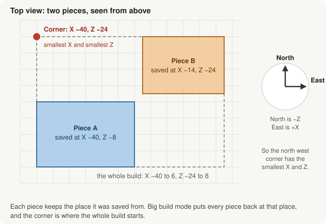
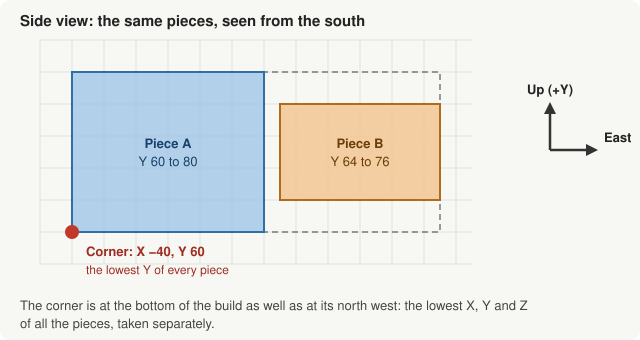

# Big Build Mode

A structure block saves at most 64 by 64 by 64 blocks. Big build mode is for
anything larger: save the build in pieces, give Scaffold every piece, and it
puts them back together as one ghost model, standing exactly where the build
stands in your world.

---

## How it works

Every structure file remembers where in the world it was saved: the position
of the corner of the structure block's box with the smallest X, Y and Z. Big
build mode reads that position from each file and lays every piece at its own
place, relative to the others, so gaps, overlaps and odd shapes all come out
the way they are in the world.

The whole model is then placed in the world by one position, the **Corner**:
the north west corner at the bottom of the whole build. In Minecraft, X grows
toward the east and Z toward the south, and Y grows upward, so that corner is
the one with the **smallest X, the smallest Y and the smallest Z** of all the
pieces, each taken on its own. It does not have to be a block of any piece.
In the picture above it is X −40 from piece A and Z −24 from piece B.

**Get Global Cords** works the corner out from the files, so you never need
to read coordinates off a structure block.

---

## Step by step

1. **Save the build in pieces.** Use a structure block in Save mode for each
   piece, and export each one. Pieces can be any size up to the structure
   block's limit and do not have to touch. Try not to let them overlap: where
   two pieces cover the same spot, the one later in Scaffold's list wins, and
   that includes its air.
2. **Add every piece** to Scaffold's list of structures.
3. **Turn on Big Build Mode.** The name tag fields step aside, because the
   whole build is one model, and the offset fields become the **Corner**.
4. **Press Get Global Cords.** The corner fills in from the files.
5. **Make the pack** and apply it to your world like any other Scaffold pack.
6. **Place one armor stand anywhere near the build.** The ghost appears where
   the build was saved. Which way the stand faces makes no difference: the
   ghost stays lined up with the world, and moving or turning the stand does
   not move it.

---

## Things to know

**One armor stand is enough.** Every armor stand that is in sight shows the
whole build at the same place, so a second one only draws it twice. The ghost
belongs to the stand, so the stand has to be close enough to you for the game
to draw it, a few dozen blocks.

**The stand's pose picks the layers.** Shift-right-click the stand to step
through the build, as with any Scaffold pack. Each step shows every twelfth
layer, counting up from the bottom of the build: one step shows layers 0, 12,
24 and so on, the next layers 1, 13, 25, and so on.

**To show the build somewhere else, change the corner.** The corner is where
the north west bottom corner of the build goes. Add 20 to its X and the ghost
appears 20 blocks further east; set it to a spot in another world and the
build appears there. Press Get Global Cords again to go back to where it was
saved.

**Blocks face the way they do in the world.** A stair, a door, a fence or a
redstone torch faces the same way in the ghost as it does in the pieces you
saved, with no need to place the stand facing any particular way.

**Turning it off gives you your settings back.** Your name tags and offsets
come back exactly as they were before you turned big build mode on.

**It is in the window only.** The command line does not offer big build mode
yet.
